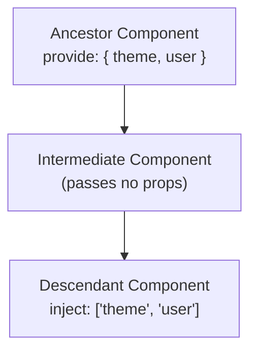

Avenx-JS provides a native **Provide & Inject** mechanism for ancestor-descendant component communication. It allows a parent or ancestor component to serve as a dependency provider for all its descendant components, regardless of how deeply nested they are, without having to pass props through intermediate components ("prop drilling").

## Single-File Components (`.component.js` & `.page.js`)

In single-file components and pages, declare dependencies directly in markup using `<provide>` and `<inject>` tags. Both tags are parsed at compile time, stripped completely from rendered HTML (rendering zero DOM elements), and registered into template validation so local injected keys are recognized without `AVX_W03`.

### 1. List Form

Declare provided and injected identifiers separated by newlines, spaces, or commas inside the tag body:

```html
<!-- Ancestor Provider (.page.js or .component.js) -->
<state theme="dark" />
<action name="setTheme"> this.state.theme = this.state.theme === 'dark' ? 'light' : 'dark'; </action>

<provide> theme setTheme </provide>

<div>
  <header />
  <MainContent />
</div>
```

```html
<!-- Descendant Consumer (.component.js) -->
<inject> theme setTheme </inject>

<div>
  <span>Current Theme: {{ theme }}</span>
  <button @click="setTheme()">Toggle Theme</button>
</div>
```

Self-closing valueless attributes are also supported: `<provide theme setTheme />` and `<inject theme setTheme />`.

### 2. Renaming Form (`<inject>`)

To avoid name collisions or use a different local identifier, map local property names to provided ancestor keys using tag attributes:

```html
<!-- Descendant Consumer with Aliased Names -->
<inject currentTheme="theme" updateTheme="setTheme" />

<div>
  <span>Active Theme: {{ currentTheme }}</span>
  <button @click="updateTheme()">Toggle Theme</button>
</div>
```

Inside the component, `currentTheme` and `updateTheme` are bound directly in template expressions, action bodies, and event handlers. Only local injected names (`currentTheme`) are registered in scope; unaliased remote names (`theme`) or undeclared identifiers trigger `AVX_W03` validation warnings as expected.

:::note[Arbitrary-expression object provide]
The arbitrary-expression object form (`provide = { customKey: () => computeValue() }`) remains available on class-based components. In SFCs, `<provide>` declares keys backed by the component's reactive `<state>`, `<computed>`, `<action>`, or `<resource>` declarations.
:::

---

## Atlas & Dependency Graph (`avenx why` / `avenx impact`)

Provide and inject relationships are modeled semantically in the Avenx Atlas compiler graph:

- **`avenx why <Consumer.injectedKey>`**: Follows dependency edges outward through `INJECTS` to find the nearest providing ancestor and the provider's backing `state` or `action`.
- **`avenx impact <Provider.stateKey>`**: Follows dependency edges inward from the provider's state or action through `PROVIDES` and `INJECTS` down to every consuming descendant component and template binding.

---

## How Provide & Inject Works

1. **Ancestor Component**: Defines `provide` (as an object, an array, or a function returning an object) to specify state, properties, or methods made available to descendants.
2. **Descendant Component**: Defines `inject` (as an array of keys or an object mapping local property names to ancestor keys) to consume provided dependencies.
3. **Targeted Reactivity**: When an injected property or reactive state changes, Avenx-JS automatically updates only the subscribing descendant components without forcing intermediate components or parent templates to re-render.



---

## Providing Dependencies (`provide`)

You can define `provide` on a component or page instance in three ways:

### 1. Object-Based `provide`

Define `provide` as an object property on your component instance:

```javascript
// Provider Component / Page
this.provide = {
  theme: 'dark',
  changeTheme: (newTheme) => {
    this.state.theme = newTheme;
  },
};
```

### 2. Function-Based `provide()`

Define `provide()` as an instance method when you need to access reactive component state dynamically:

```javascript
// Provider Page / Component
export default class UserProfilePage extends AvenxPage {
  provide() {
    return {
      theme: this.state.currentTheme,
      role: this.state.userRole,
    };
  }
}
```

### 3. Array-Based `provide`

Provide state properties directly by name from your component's reactive `state`:

```javascript
// Provider Component
this.provide = ['color', 'mode'];
```

---

## Injecting Dependencies (`inject`)

Descendant components declare dependencies using `inject`, which can be specified as a static property on the component class or an instance property:

### 1. Array-Based `inject`

Inject properties using the exact key names defined by ancestor components:

```javascript
import { AvenxComponent } from 'avenx-core/runtime';

export default class ThemeBadge extends AvenxComponent {
  static inject = ['theme'];

  constructor(bridges, props) {
    super({}, {}, bridges, '<span class="badge {{ theme }}">Current Theme: {{ theme }}</span>', {}, props);
  }
}
```

Inside the child component template, `{{ theme }}` and `this.theme` are accessible directly and resolve to the value provided by the nearest ancestor.

### 2. Object-Based `inject` (Aliasing / Property Mapping)

Inject ancestor properties under custom local names:

```javascript
import { AvenxComponent } from 'avenx-core/runtime';

export default class UserCard extends AvenxComponent {
  // Maps local 'activeRole' property to ancestor provided key 'role'
  static inject = {
    activeRole: 'role',
    activeTheme: 'theme',
  };

  constructor(bridges, props) {
    super({}, {}, bridges, '<div>User Role: {{ activeRole }} (Theme: {{ activeTheme }})</div>', {}, props);
  }
}
```

---

## Reactivity & Scope Shadowing

### Targeted Reactivity Updates

When an ancestor component updates a provided property or reactive state:

- All child components injecting that property receive targeted reactivity updates and re-render.
- Intermediate components that do not inject the property are **not** re-rendered, optimizing runtime rendering performance.

### Ancestor Scope Shadowing

If multiple ancestors in a nested hierarchy provide the same key, a descendant component resolves the value from the **nearest ancestor** in its parent chain:

```text
Grandparent provides { theme: 'dark', apiVersion: 'v1' }
  ↓
Intermediate parent provides { theme: 'light' }
  ↓
Child injects ['theme', 'apiVersion']
Result: Child receives theme = 'light' (shadowed) and apiVersion = 'v1' (inherited from grandparent)
```

---

## Real-World Example: Theme & State Provider

Below is an end-to-end example demonstrating how an application layout page provides theme state and a toggle action to a nested child button. Both files are ordinary `.js` modules (not `.page.js` / `.component.js` templates). Register them in `src/main.app.js` before routing.

### Ancestor Provider (`src/pages/AppLayout.js`)

The page constructor receives the app's component registry (`Map`) as its second argument when the page is mounted through `app.registerPage`. Child tags resolve through that registry, so register `ThemeToggleButton` on the app (see below) rather than embedding it in the page file.

```javascript
import { AvenxPage } from 'avenx-core/runtime';

export default class AppLayout extends AvenxPage {
  constructor(bridges, componentRegistry, props) {
    super(
      { theme: 'dark', username: 'Alice' },
      {},
      bridges,
      `<div>
  <header>
    <h2>Welcome, {{ username }}</h2>
  </header>
  <main class="app-content">
    <div data-avenx-comp="ThemeToggleButton"></div>
  </main>
</div>`,
      {},
      componentRegistry,
      props,
    );
  }

  provide() {
    return {
      theme: this.state.theme,
      toggleTheme: () => {
        this.state.theme = this.state.theme === 'dark' ? 'light' : 'dark';
      },
    };
  }
}
```

### Deeply Nested Consumer (`src/components/ThemeToggleButton.js`)

```javascript
import { AvenxComponent } from 'avenx-core/runtime';

export default class ThemeToggleButton extends AvenxComponent {
  static inject = ['theme', 'toggleTheme'];

  constructor(bridges, props) {
    super(
      {},
      {},
      bridges,
      '<button @click="handleClick()">Switch theme (Current: {{ theme }})</button>',
      {
        handleClick() {
          this.toggleTheme();
        },
      },
      props,
    );
  }
}
```

### Registration (`src/main.app.js`)

```javascript
import AppLayout from './pages/AppLayout.js';
import ThemeToggleButton from './components/ThemeToggleButton.js';

app.register('ThemeToggleButton', ThemeToggleButton);
app.registerPage('AppLayout', AppLayout);
```

Mount or route to `AppLayout`. The button renders `Switch theme (Current: dark)` and toggles the injected theme when clicked.
